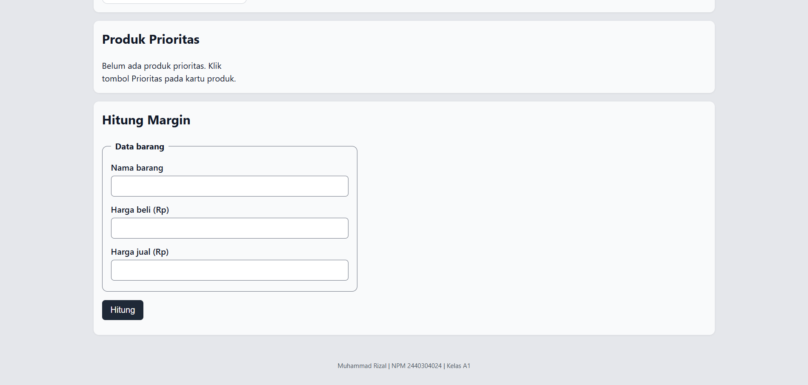
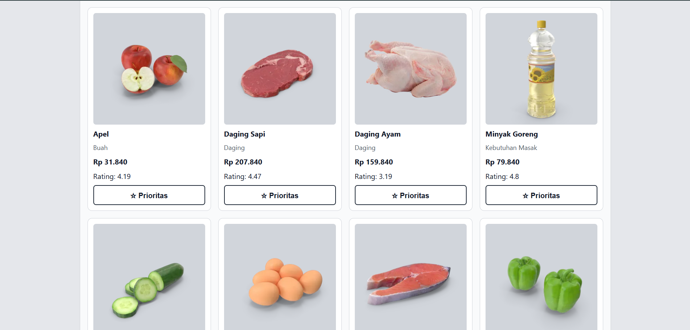
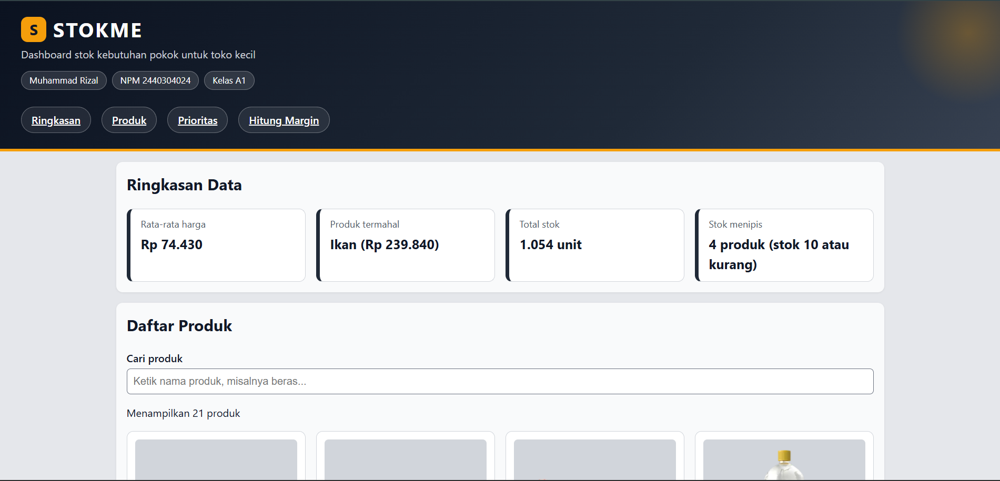
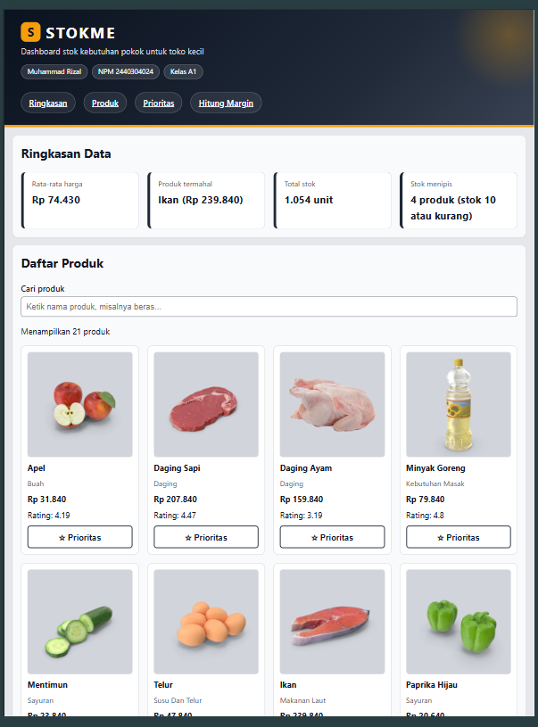

# STOKME - Dashboard Stok Kebutuhan Pokok

**Nama:** Muhammad Rizal
**NIM:** 2440304024
**Kelas:** A1
**Mata Kuliah:** Pemrograman Web (26TJ453127) - Program Studi Teknik Komputer, Universitas Borneo Tarakan

## Deskripsi Aplikasi

STOKME adalah dashboard stok sederhana untuk pemilik toko kecil yang menjual kebutuhan pokok.
Pengguna dapat mencari produk, menandai produk prioritas, melihat ringkasan data (rata-rata
harga, produk termahal, total stok, stok menipis), dan menghitung margin keuntungan lewat form.

**Konteks penggunaan:** pemilik toko kecil yang ingin memantau barang dan menentukan produk prioritas.

**Rancangan visual:** tema abu-abu dan hitam dengan aksen kuning. Warna diatur lewat CSS variables.

**Catatan data:** data berasal dari kategori `groceries` pada dataset Products DummyJSON.
Nama produk dan jenis diterjemahkan ke bahasa Indonesia hanya pada tampilan, dan harga
dikonversi dari USD ke Rupiah saat ditampilkan (kurs asumsi 1 USD = Rp16.000, konstanta
`USD_TO_IDR`). Karena sumbernya data contoh, harga tidak mencerminkan harga pasar sebenarnya.
Enam produk yang bukan kebutuhan pokok (makanan hewan, protein powder, tisu, es krim,
minuman soda) disaring dengan `filter()`.

## Perhitungan Varian Berdasarkan NIM

NIM berakhir **024**, sehingga **X = 0, Y = 2, Z = 4**.

| Komponen | Nilai | Hasil |
|---|---|---|
| Dataset (X) | 0 | Products |
| Fitur utama (Y) | 2 | Favorite/Bookmark menggunakan localStorage |
| Validasi form (Z) | 4 | Dua input yang saling berkaitan divalidasi |
| Challenge | S = 0 + 2 + 4 = 6, C = 6 mod 4 = 2 | Loading indicator + pencarian dengan debounce |

## Fitur Utama dan Challenge

| Fitur | Keterangan |
|---|---|
| Daftar produk | Data dari REST API ditampilkan sebagai kartu |
| Produk prioritas (Y=2) | Tombol Prioritas, daftar disimpan di localStorage |
| Form hitung margin (Z=4) | Harga jual harus lebih besar dari harga beli |
| Debounce search (C=2) | Pencarian berjalan 400 ms setelah pengguna berhenti mengetik |
| Loading indicator (C=2) | Spinner dan teks status saat data dimuat |
| Loading, success, error state | Pesan berbeda untuk jaringan putus, HTTP 404, dan HTTP 500 |
| Ringkasan data | Dihitung JavaScript dengan `reduce()` dan `filter()` |

## Analisis Data (dihitung dengan JavaScript)

Fungsi `calculateStats()` menghasilkan: rata-rata harga, produk termahal, total stok, dan
jumlah produk dengan stok menipis (stok 10 atau kurang).

## Dataset / Endpoint REST API

| Keterangan | Detail |
|---|---|
| Penyedia | DummyJSON |
| Method | GET |
| Endpoint | `https://dummyjson.com/products/category/groceries?limit=100` |
| Format respons | JSON, array produk ada di properti `products` |
| Fungsi pemanggil | `loadData()` di `js/app.js` |

## Teknologi

HTML5 (semantic HTML), CSS3 (Flexbox, Grid, media query, CSS variables), Vanilla JavaScript
(Fetch API, async/await, DOM, Web Storage). Tidak memakai framework atau library eksternal.

## Struktur Project

```
Pemweb-pts-024/
├── css/style.css
├── Gambar/.gitignore/Desktop1.png/Desktop2.png/Desktop3.png/Mobile.png
├── js/app.js
├── index.html
└── README.md
```

## Cara Menjalankan

1. Clone repository:
```bash
   git clone https://github.com/zzal18/Pemweb-pts-024.git
   cd Pemweb-pts-024
```
2. Buka `index.html` di browser, atau jalankan dengan web server lokal (Laragon atau Live Server).
3. Pastikan terhubung ke internet karena data diambil dari REST API.
4. Tidak perlu instalasi paket apa pun.

## Aksesibilitas dan Responsive

- Elemen semantik: `header`, `nav`, `main`, `section`, `form`, `fieldset`, `output`, `footer`
- Skip link, label pada semua input, fokus keyboard yang jelas
- Pesan error berupa teks (⚠) dengan `aria-invalid`, bukan hanya warna
- Breakpoint: mobile 1 kolom, tablet (>= 768px) 2 kolom, desktop (>= 1024px) 4 kolom

## Screenshot

### Desktop




### Mobile


## Jawaban Pertanyaan Penjelasan Kode

### 1. Alur dari halaman dibuka sampai data tampil
Saat HTML selesai dimuat, event `DOMContentLoaded` memanggil `init()`. `init()` memanggil
`loadData()` lalu memasang event listener. `loadData()` menampilkan loading (`showLoading()`),
memanggil `fetch(API_URL)`, memeriksa `response.ok`, mengubah respons dengan `response.json()`,
menyaring produk dengan `filter()` ke variabel `allProducts`, lalu memanggil `renderStats()`,
`renderProducts()`, dan `renderFavorites()`. Blok `finally` menjalankan `hideLoading()`.

### 2. Mengapa response.ok tetap diperiksa
`fetch()` hanya ditolak saat jaringan gagal. Jika server membalas 404 atau 500, `fetch()` tetap
dianggap berhasil dan `response.json()` bisa gagal atau menghasilkan data yang salah. Dengan
`response.ok`, status selain 200-299 saya ubah menjadi error (`throw new Error`). Contoh pada
STOKME: jika endpoint salah ketik (`/groceriess`), server membalas 404, `response.ok` bernilai
false, alur masuk ke `catch`, dan pesan "Data tidak ditemukan di server (HTTP 404)" tampil.

### 3. Data JSON menjadi elemen DOM
Contoh data: `{ "id": 38, "title": "Rice", "price": 5.99, "tags": ["grains"], "stock": 59, ... }`.
`renderProducts()` memanggil `renderList()`, yang mengulang array dengan `forEach` dan
memanggil `createProductCard(product)` untuk tiap produk. Fungsi itu membuat `li` dan
`article` dengan `createElement`. `title` diterjemahkan oleh `translateTitle()` menjadi "Beras"
dan dimasukkan ke `h3` lewat `textContent`, `thumbnail` ke `src` pada `img` (dengan `alt`),
`price` diformat `formatPrice()` menjadi Rupiah, dan `tags[0]` diterjemahkan menjadi "Biji-bijian".
Elemen disusun dengan `append`, dikumpulkan di `DocumentFragment`, lalu ditempel ke
`ul#product-list`.

### 4. Internet terputus, endpoint salah, atau HTTP 404/500
- Internet terputus: `fetch()` melempar `TypeError`, masuk `catch`, dan `getErrorMessage()`
  menampilkan "Tidak dapat terhubung ke server".
- Endpoint salah atau server membalas 404/500: `response.ok` bernilai false, dilempar `Error`
  berisi kode status, dan `getErrorMessage()` menampilkan pesan sesuai kode.
- Pada semua kasus, `finally` menjalankan `hideLoading()` sehingga spinner tidak menggantung,
  dan `renderStats([])` menampilkan "Statistik belum tersedia".

### 5. Fitur berdasarkan digit Y (Favorite/Bookmark)
Setiap kartu memiliki tombol "Prioritas". Satu event listener `click` dipasang pada
`#product-list` dan `#favorite-list` (event delegation) yang memanggil `handleFavoriteClick()`.
Fungsi itu mencari tombol dengan `closest(".favorite-btn")`, lalu memanggil `toggleFavorite(id)`
yang menambah atau menghapus ID di array `favoriteIds`. Setelah itu `saveFavorites()` menyimpan
ke localStorage, `syncFavoriteButtons()` memperbarui tombol, dan `renderFavorites()` menampilkan
ulang section Produk Prioritas.

### 6. Validasi berdasarkan digit Z (dua input saling berkaitan)
Form "Hitung Margin" memiliki nama barang, harga beli, dan harga jual. Dua input yang saling
berkaitan adalah harga beli dan harga jual: harga jual harus lebih besar dari harga beli.
Saat tombol Hitung ditekan, event `submit` memanggil `handleFormSubmit()` yang memanggil
`event.preventDefault()`. Fungsi ini menjalankan `validateItemName()`, `validateBuyPrice()`,
`validateSellPrice()`, lalu `validatePricePair()` yang membandingkan kedua harga (hanya jika
keduanya sudah valid sendiri-sendiri). Jika ada yang salah, pesan teks ber-ikon ⚠ tampil di
bawah input (`role="alert"`), input diberi `aria-invalid="true"`, fokus pindah ke input
pertama yang salah, dan perhitungan tidak dijalankan. Jika semua valid, margin dihitung oleh
`calculateMargin()` dan ditampilkan di elemen `output`.
Input tidak valid tidak boleh langsung diproses karena hasil hitungan menjadi salah atau `NaN`,
margin negatif menyesatkan, aplikasi bisa berperilaku tak terduga, dan pengguna tidak tahu apa
yang harus diperbaiki.

### 7. Penggunaan localStorage
Data yang disimpan adalah array ID produk favorit dengan key `stokme-favorites` (contoh
`[38,23]`) dalam format JSON. Data dibaca sekali saat aplikasi dimuat lewat `loadFavorites()`,
dan ditulis setiap pengguna menandai atau melepas favorit lewat `saveFavorites()`. Alasannya
agar daftar prioritas tidak hilang saat halaman di-refresh atau browser ditutup. Hanya ID yang
disimpan, karena data produk selalu diambil terbaru dari API.

### 8. Fungsi penting: filterProducts
```javascript
function filterProducts(keyword) {
    const query = keyword.trim().toLowerCase();
    if (query === "") {
        return allProducts;
    }
    return allProducts.filter((product) => {
        const indonesianName = translateTitle(product.title).toLowerCase();
        const originalName = product.title.toLowerCase();
        return indonesianName.includes(query) || originalName.includes(query);
    });
}
```
- **Input:** `keyword`, teks dari kolom pencarian.
- **Proses:** teks dibersihkan dengan `trim()` dan `toLowerCase()`. Jika kosong, semua produk
  dikembalikan. Jika tidak, `filter()` memeriksa tiap produk: nama Indonesia atau nama aslinya
  harus mengandung kata kunci (`includes`).
- **Output:** array produk yang cocok, yang ditampilkan oleh `renderProducts()`.

### 9. Bug tersulit
Produk tidak tampil sama sekali dan tidak ada pesan error di layar. Penyebabnya, deklarasi
`const searchInputEl` dan teman-temannya tertempel di dalam fungsi `renderProducts`, sehingga
hanya berlaku di dalam fungsi itu (scope lokal). Ketika `init()` memakainya terjadi
`ReferenceError` dan `loadData()` tidak pernah dipanggil. Saya menemukannya lewat tab Console
di DevTools yang menampilkan nama error dan nomor barisnya. Perbaikannya memindahkan semua
referensi DOM ke luar fungsi (scope global) dan merapikan kurung kurawal yang tidak seimbang.

### 10. Dua perbaikan teknis jika ada waktu seminggu
1. Menambah batas waktu permintaan (timeout) dengan `AbortController` dan tombol "Coba lagi"
   pada pesan error, supaya pengguna dengan koneksi lambat tidak menunggu tanpa batas.
2. Memecah `app.js` menjadi beberapa modul (`api.js`, `render.js`, `form.js`) dengan ES modules,
   supaya kode lebih mudah dirawat dan diuji, karena sekarang semuanya ada di satu file.

## AI Usage Log

| Tanggal | AI/Tool | Tujuan | Prompt/Ringkasan | Bagian Digunakan | Verifikasi/Modifikasi |
|---|---|---|---|---|---|
| 15 Okt 2026 | Claude | Memahami soal dan menentukan varian NIM | Meminta ringkasan soal dan perhitungan varian | README (perhitungan varian) | Dihitung ulang sendiri dan dicocokkan dengan tabel soal |
| 15 Okt 2026 | Claude | Struktur project, HTML semantik, CSS responsive | Meminta panduan langkah demi langkah | index.html, css/style.css | Diuji di DevTools (375/768/1280px), warna dan nama aplikasi ditentukan sendiri |
| 15 Okt 2026 | Claude | Fetch API, render DOM, lokalisasi data | Meminta panduan fetch, async/await, createElement, filter kategori | js/app.js (loadData, createProductCard, renderProducts) | Dicek di Console dan tab Network, diuji endpoint salah (404) dan mode Offline |
| 15 Okt 2026 | Claude | Pencarian debounce dan loading | Meminta panduan debounce dan closure | js/app.js (debounce, filterProducts, handleSearch) | Diuji mengetik cepat dan throttling Slow 3G |
| 15 Okt 2026 | Claude | Mendiagnosis bug tampilan kosong | Mengirim kode dan screenshot untuk dicari penyebabnya | js/app.js (posisi deklarasi DOM) | Dicari lewat Console (ReferenceError), diperbaiki dengan memindahkan deklarasi |
| 15 Okt 2026 | Claude | Favorit localStorage dan validasi form | Meminta panduan localStorage, JSON, validasi | js/app.js (toggleFavorite, handleFormSubmit, validatePricePair) | Diuji refresh, keyboard, semua kombinasi isian form |
| 15 Okt 2026 | Claude | Statistik dan penanganan error | Meminta panduan reduce dan pesan error | js/app.js (calculateStats, getErrorMessage) | Angka statistik dicek manual, diuji 404 dan Offline |
| 15 Okt 2026 | Claude | Menyusun README dan draf jawaban | Meminta kerangka README dan draf jawaban | README.md | Jawaban ditulis ulang dengan kata-kata sendiri dan dicocokkan dengan kode |
